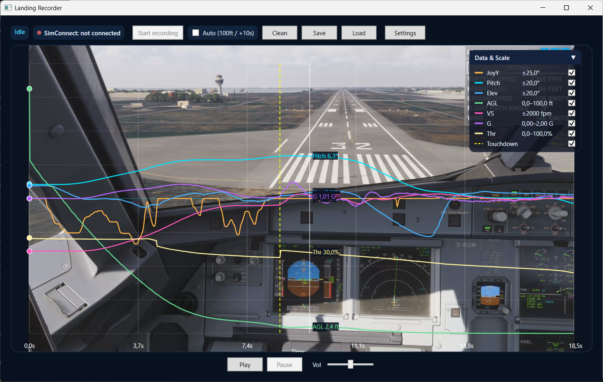
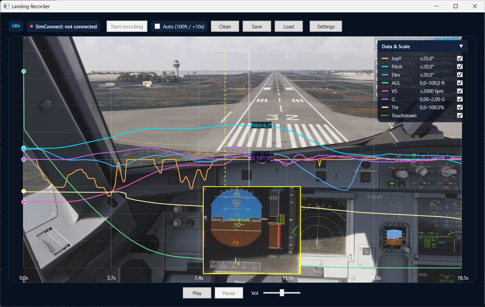
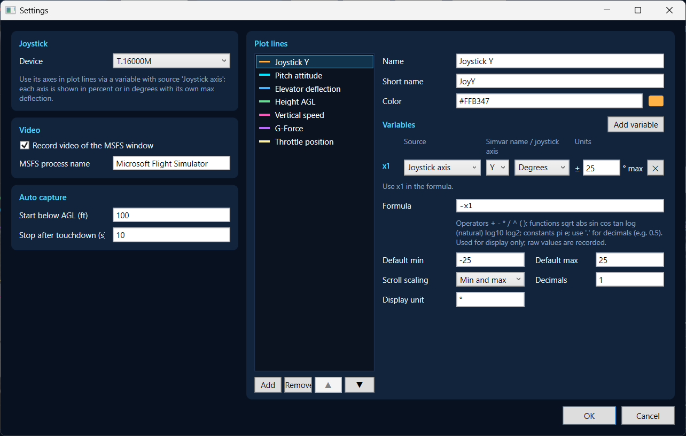
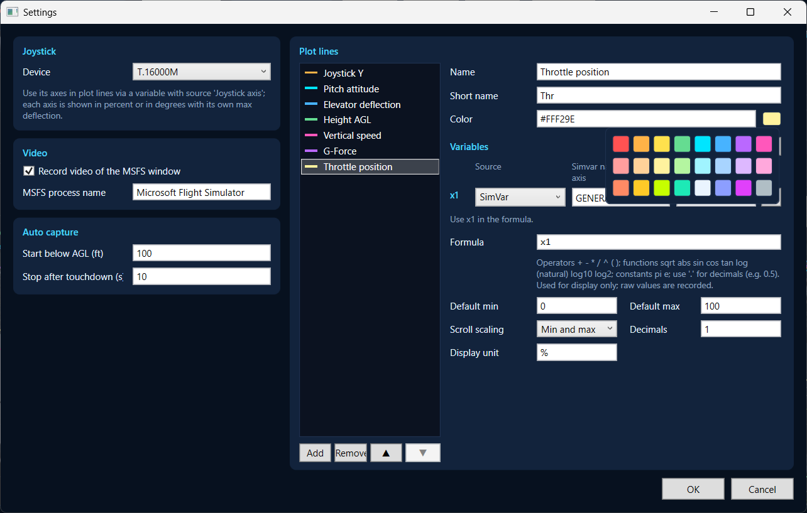
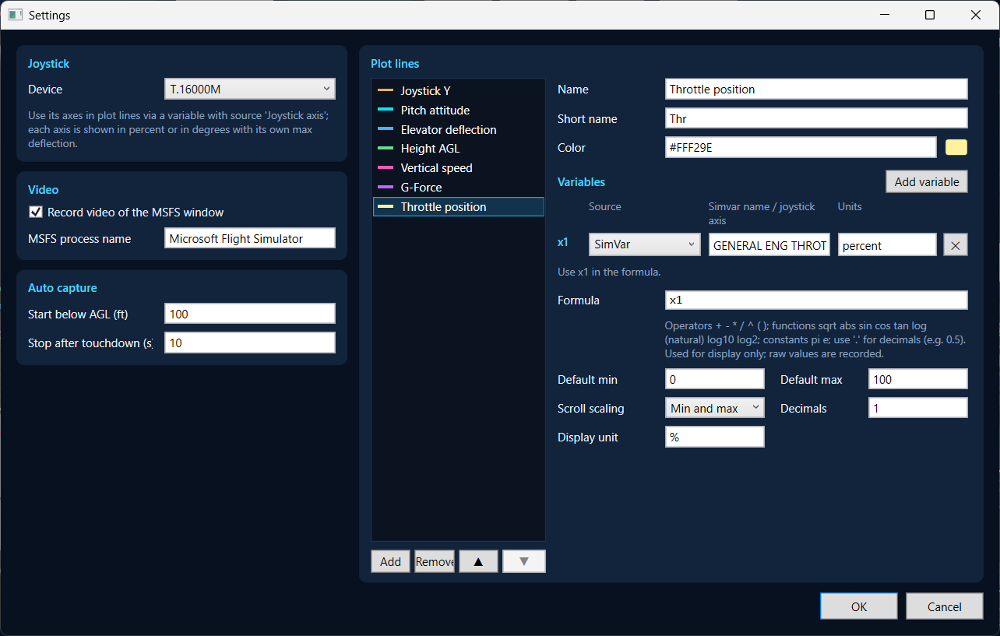

# Landing Recorder

A Windows desktop tool for **Microsoft Flight Simulator** that records your landings and lets you review them afterwards. It records:

- **flight data** from the simulator via SimConnect (pitch, elevator, height above ground, vertical speed, G-force, or any other simvar you configure), plus your **joystick axes**;
- a **video (with sound) of the simulator window**, kept in sync with the data.

After the flight, the data is drawn as a graph on top of the video. Drag across the graph to scrub through the landing frame by frame and read the exact values at any moment, including the touchdown moment.



---

## Contents

- [Requirements](#requirements)
- [Building from source](#building-from-source)
- [User manual](#user-manual)
  - [Main window overview](#main-window-overview)
  - [Connecting to the simulator](#connecting-to-the-simulator)
  - [Recording a landing](#recording-a-landing)
  - [Output files](#output-files)
  - [Reviewing a recording](#reviewing-a-recording)
  - [The "Data & Scale" legend](#the-data--scale-legend)
  - [Adjusting line scales on the graph](#adjusting-line-scales-on-the-graph)
  - [Magnifier](#magnifier)
  - [Save, Load and Clean](#save-load-and-clean)
  - [Settings](#settings)
  - [Plot lines and formulas](#plot-lines-and-formulas)
  - [Files next to the executable](#files-next-to-the-executable)
- [Known limitations](#known-limitations)
- [Project layout](#project-layout)

---

## Requirements

### To run

- Windows 10 (version 2004 or newer) or Windows 11, 64-bit. Video capture uses `Windows.Graphics.Capture`, and audio capture uses per-process WASAPI loopback.
- [.NET 8 Desktop Runtime](https://dotnet.microsoft.com/download/dotnet/8.0) (x64).
- Microsoft Flight Simulator 2024, running on the same PC. MSFS 2020 uses the same SimConnect protocol and should also work, but it hasn't been tested.
- Optional: a DirectInput joystick, if you want to record your stick inputs.

### To build

- [.NET 8 SDK](https://dotnet.microsoft.com/download/dotnet/8.0) or newer (it must be able to target `net8.0-windows10.0.19041.0`; the Windows SDK projection used for screen capture comes with the .NET SDK, so no separate Windows SDK install is needed).
- **MSFS 2024 SDK**, which provides the SimConnect managed wrapper. Install it from the simulator (Developer Mode → Help → SDK Installer) or from the MSFS SDK download page. The build looks for the files here by default:

  ```
  C:\MSFS2024SDK\SimConnect SDK\lib\managed\Microsoft.FlightSimulator.SimConnect.dll
  C:\MSFS2024SDK\SimConnect SDK\lib\SimConnect.dll
  ```

  If your SDK is installed somewhere else, set the `MSFS2024SDKPath` environment variable, or pass `-p:MSFS2024SDKPath=...`, pointing to the folder that contains `Microsoft.FlightSimulator.SimConnect.dll`. If the SDK is missing, the build stops with an error message that says how to fix it.

NuGet packages (SharpDX for DirectInput/Direct3D 11/Media Foundation, and the Windows SDK projection) are restored automatically.

## Building from source

The repository has no `.sln`. Run commands from the repository root, which contains `LandingRecorder.csproj`.

### Release build

```powershell
dotnet build -c Release
```

Output: `bin\Release\net8.0-windows10.0.19041.0\LandingRecorder.exe`. Run it from that folder.

If your SDK is not in the default location:

```powershell
dotnet build -c Release -p:MSFS2024SDKPath="D:\MSFS2024SDK\SimConnect SDK\lib\managed"
```

### Release package (folder to copy or distribute)

```powershell
dotnet publish -c Release -r win-x64 --self-contained false -o publish
```

The `publish\` folder contains everything the app needs, including the native `SimConnect.dll`, apart from the .NET 8 Desktop Runtime. Zip the folder and copy it anywhere. To avoid needing the runtime on the target machine, use `--self-contained true` instead (the output is larger).

### Debug run and tests

```powershell
dotnet run                                       # build and start the app (Debug)
dotnet test LandingRecorder.Tests                # unit tests: formula engine, settings, recording files
dotnet run --project VideoCaptureManualTest      # manual check of the video/audio capture pipeline
```

Neither the tests nor the capture test harness need the MSFS SDK.

---

## User manual

### Main window overview

| Element | What it does |
|---|---|
| **Idle / Recording** | Shows whether a recording is in progress. |
| **SimConnect: connected / not connected** | Simulator connection status. The dot turns green when connected. |
| **Start recording / Stop recording** | Starts or stops a recording manually. Available only while connected to the simulator. |
| **Auto (100ft / +10s)** checkbox | Turns on automatic capture. The label shows the current start height and stop delay. See [Recording a landing](#recording-a-landing). |
| **Clean** | Clears the current data and video from the screen. Files on disk are not touched. |
| **Save** | Saves the data on screen to a JSON file of your choice. |
| **Load** | Opens a previously recorded JSON file, and its video if one is next to it. |
| **Settings** | Opens the [Settings](#settings) dialog. Disabled while recording. |
| Graph area | Video of the landing with the plot lines drawn on top. The time axis runs along the bottom. |
| **Data & Scale** panel | The legend: line visibility and Y scales. |
| **Play / Pause / Vol** | Video playback controls and volume. The "Vol" label is struck through when the volume is zero. |

### Connecting to the simulator

Start the app and MSFS in any order. The app tries to connect to SimConnect every 5 seconds until it succeeds, and reconnects automatically if the simulator is restarted. You don't need to do anything else. While it is not connected, you can still load and review earlier recordings.

### Recording a landing

There are two ways to record, and you can combine them.

**Manually:** press **Start recording**, fly, then press **Stop recording**. Recording starts and stops immediately, with no conditions.

**Automatically:** tick **Auto (…)**. Then:

1. When the aircraft **descends through the start height** above ground level (100 ft AGL by default), recording starts.
2. When the simulator reports **touchdown** (the aircraft's "on ground" flag changes from false to true), the app starts a timer.
3. A set number of **seconds after touchdown** (10 s by default), recording stops.

You can change both values in [Settings](#settings). The manual button still works in auto mode. For example, you can stop an auto-started recording early, or start one by hand before reaching the start height. With **Auto** unticked, nothing starts or stops by itself.

The **touchdown moment** is always stored in the recording, in both modes, and appears on the graph as a dashed yellow vertical line.

During recording, the app stores the values of every variable used by the configured plot lines, about 60 times per second, and video of the simulator window at 60 fps. Recordings are limited to the most recent 10,000 data points, which is a little under 3 minutes.

### Output files

When a recording stops, its files are saved automatically to the **Save recordings to** folder from Settings (by default, **next to `LandingRecorder.exe`**), with names based on the time the recording started:

| File | Contents |
|---|---|
| `flight-YYYYMMDD-HHMMSS.mp4` | H.264 video of the simulator window, including the simulator's sound. |
| `flight-YYYYMMDD-HHMMSS.json` | The recorded data, saved under the same name as the video. |

If video recording is turned off in Settings, or the simulator window can't be found, only the `.json` file is written. Nothing is saved if no data points were recorded.

The JSON file stores **raw values exactly as received** (`{"Variables": {name: units}, "Points": [{"TimeSeconds", "Values": {...}, "TouchdownSim"?}]}`). Formulas are applied only when the data is displayed. This means you can change a line's formula, scale or color later and every old recording redraws with the new settings.

### Reviewing a recording

When a recording stops, or when you **Load** a file, the graph shows the data. If a matching `.mp4` exists next to the `.json`, the video appears behind the graph.

- **Click or drag on the graph** (left mouse button) to move the white cursor line. The video jumps to that moment, and every visible line shows a label with its value there, for example `Pitch 6.3°` or `AGL 2.4 ft`. The cursor also shows the time.
- **Play / Pause** play the video. The cursor follows playback, so the value labels update as the video runs. Pressing Play at the end of the video starts again from the beginning.
- The video stays paused while you drag, and audio is muted during the drag to avoid choppy sound. If the video was playing before the drag, playback resumes when you release the mouse button.
- The **dashed yellow line** marks the moment of touchdown.

Each line is scaled independently. Every line has its own minimum–maximum range mapped onto the full height of the graph. Values outside a line's range are drawn at the top or bottom edge, so a spike never goes off the graph.

### The "Data & Scale" legend

The panel in the top-right corner of the graph (see the first screenshot) has one row per plot line:

- a **color swatch** and the line's **short name**. Hover over the row to see the full name;
- the line's **current range**, for example `±20.0°` or `0.0–100.0 ft`. **Scroll the mouse wheel over the range** to zoom that line in (wheel up) or out (wheel down) by 10% per notch. Which end of the range moves depends on the line's *Scroll scaling* setting: both ends, min only, or max only;
- a **checkbox** to show or hide the line.

The last row, **Touchdown**, shows or hides the touchdown marker.

A row is **dimmed** when its line can't be drawn for the loaded data. For example, the recording doesn't contain that variable, or recorded it in different units. Hover over the dimmed row to see the reason.

**Drag the panel by its title bar** to move it anywhere on the graph. Click **▼ / ▶** to collapse or expand it.

### Adjusting line scales on the graph

Each drawn line has a **colored dot at its starting point**. Hover over the dot to see a short hint.

| Action on the dot | Effect |
|---|---|
| **Left-drag up/down** | Moves the line vertically by shifting its range. |
| **Mouse wheel** | Zooms the line's range around the dot's value, so the dot stays under the mouse. |
| **Right-click** | Resets the line's range to the default from Settings. |

Changes to ranges only affect the current view. They reset to the configured defaults when settings are applied.

### Magnifier



**Right-drag a rectangle** anywhere over the video. When you release the button, the app shows a **live 2× magnified copy** of that area in a yellow frame. It keeps updating while the video plays or you scrub. This is handy for reading the PFD, the speed tape or the runway markings.

- **Left-drag** the magnified frame to move it.
- **Right-click** the frame, or right-click anywhere on the graph without dragging, to remove it.
- Loading another recording or pressing **Clean** also removes it.

### Save, Load and Clean

- **Load** opens a `.json` recording. If a `.mp4` with the same name is in the same folder, the video is opened as well.
- **Save** writes the data on screen to a new `.json` file. Recordings are saved automatically when they stop, so you only need this to make a copy. The video file is not copied.
- **Clean** empties the graph and closes the video.

Save, Load and Settings are disabled while a recording is in progress.

### Settings

Changes in the Settings dialog apply only when you press **OK**, and are saved to `settings.json`. **Cancel** discards them. **OK** is disabled, and an error is shown in red, while any field is invalid: for example, a formula that doesn't parse, or the same simvar used with two different units.

**Joystick**

- **Device**: the DirectInput joystick whose axes can be recorded. Choose **None** to not record joystick input. A saved device that is currently unplugged is shown as "(not connected)" and stays selected. At the start of every recording, the app checks again whether the device is present, so you can plug it back in at any time.

**Video**

- **Record video of the MSFS window**: turns video capture on or off. With it off, only data is recorded.
- **MSFS process name**: how the app finds the simulator window. An exact process name match is tried first, then a part of the window title. The default is `Microsoft Flight Simulator`. It matches the title of the simulator's window.

**Auto capture**

- **Start below AGL (ft)**: auto-capture starts when the aircraft descends through this height above ground.
- **Stop after touchdown (s)**: auto-capture stops this many seconds after touchdown.
- **Save recordings to**: the folder where recordings (`.json` and `.mp4`) are saved automatically when they stop. **Load** and **Save** also open in this folder. By default it is the program's folder. Use **Browse…** to pick a folder, or clear the field to go back to the default. The folder is created when a recording starts, if it doesn't exist yet.

**Plot lines**: see the next section.

### Plot lines and formulas



Everything drawn on the graph, and everything recorded apart from the touchdown flag, is defined by the **plot lines**. The default set is:

| Line | Source | Formula | Notes |
|---|---|---|---|
| Joystick Y (`JoyY`) | Joystick Y axis, shown in degrees (±25° max) | `-x1` | Pushing forward is positive. |
| Pitch attitude (`Pitch`) | `PLANE PITCH DEGREES`, degrees | `-x1` | SimConnect reports nose-down as positive, so the value is negated: nose-up is positive. |
| Elevator deflection (`Elev`) | `ELEVATOR DEFLECTION`, degrees | `-x1` | Same sign convention as pitch. |
| Height AGL (`AGL`) | `PLANE ALT ABOVE GROUND`, feet | `x1` | |
| Vertical speed (`VS`) | `VELOCITY WORLD Y`, feet/minute | `x1` | |
| G-Force (`G`) | `G FORCE`, GForce | `x1` | |

Use the list on the left to **Add**, **Remove** and reorder (▲ ▼) lines. The order of the list is the order of the legend. For the selected line, you can edit:

- **Name**: the descriptive name, shown as the legend tooltip.
- **Short name**: shown in the legend and in the cursor value labels.
- **Color**: a `#RRGGBB` (or `#AARRGGBB`) value. Or click the swatch to pick from a palette of colors chosen to be easy to read on the dark graph:

  

- **Variables**: the inputs to the formula, named `x1`, `x2`, … in list order. Each variable has a **Source**:
  - **SimVar**: a SimConnect simulation variable name (e.g. `PLANE PITCH DEGREES`, `GENERAL ENG THROTTLE LEVER POSITION:1`) and its **units** (e.g. `degrees`, `feet`, `feet/minute`, `percent`). See the MSFS SDK documentation for the list of simvars. If you enter a simvar name the simulator doesn't recognize, only that variable is lost (the error is written to `app.log`).
  - **Joystick axis**: X, Y, Z, X/Y/Z rotation, Slider 1 or Slider 2. Axes that the selected joystick doesn't have are listed as "(not on device)" and can't be selected. Axes are always *recorded* as percent of full deflection (−100…100). The display scale can be **Percent**, or **Degrees** with a maximum deflection you set (e.g. ±25°). Because the scale only affects display, changing it also changes how old recordings are shown.

  

- **Formula**: how the variables are combined into the plotted value. Supported:
  - operators `+ - * / ^` and parentheses. `^` is power and binds tighter than unary minus, so `-x1^2` means `-(x1^2)`;
  - functions `sqrt abs sin cos tan log log10 log2` (`log` is the natural logarithm; functions need parentheses);
  - constants `pi` and `e`;
  - always use `.` as the decimal separator, e.g. `x1*0.5`, whatever your Windows language settings.

  Examples: `-x1` (invert), `x1-9` (subtract the height of the gear above the ground when parked), `x1/x2`, `sqrt(x1^2+x2^2)`. Points where the result can't be computed (e.g. division by zero, or a missing value) are skipped and leave a gap in the line.
- **Default min / Default max**: the line's initial Y range.
- **Scroll scaling**: which end of the range moves when you scroll over the line's range in the legend: **Min and max**, **Min only** or **Max only**. For example, *Max only* suits height AGL, so that 0 ft stays at the bottom.
- **Decimals** and **Display unit**: how values are formatted in the legend and value labels (e.g. `1` and `°` give `6.3°`).

Each simvar is requested from the simulator only once, even if several lines use it. All lines therefore have to use the same units for a given simvar.

When you load a recording, each line is matched against the recorded variables and their units. Lines whose data isn't in the file are dimmed in the legend rather than drawn incorrectly.

### Files next to the executable

| File | Purpose |
|---|---|
| `settings.json` | Your settings. Delete it to go back to the defaults. Any setting missing from the file uses its default value. |
| `flight-*.json`, `flight-*.mp4` | Recordings, unless another folder is set in Settings (see [Output files](#output-files)). |
| `app.log` | Diagnostic log. It is kept across runs and rotated at 1 MB (`app-1.log` … `app-5.log`, newest has the highest number). Check it if video or a simvar doesn't record. |

---

## Known limitations

- **Resizing the simulator window during a recording**, or switching to or from fullscreen, freezes the video for the rest of that recording. The next recording works normally.
- **Go-around without touchdown:** auto-capture stops only after a touchdown. If you go around after an auto-started approach, recording continues until the next touchdown, or until you stop it manually. The same happens if you reset a flight from the air onto the runway.

## Project layout

| Path | Contents |
|---|---|
| `LandingRecorder.csproj` | The WPF application (.NET 8, `net8.0-windows10.0.19041.0`). |
| `WindowVideoCapture/` | Class library for window capture (Windows.Graphics.Capture + Direct3D 11), H.264/AAC encoding (Media Foundation), process-loopback audio capture, and the logger. Does not use SimConnect. |
| `VideoCaptureManualTest/` | Console harness that records a test window to check the capture/encoding pipeline. |
| `LandingRecorder.Tests/` | xUnit tests for the formula engine, settings and recording models, and log rotation. |
| `docs/screenshots/` | Images used in this README. |

See [CLAUDE.md](CLAUDE.md) for a detailed description of the architecture.

## License

The source code is released under the [MIT License](LICENSE).

Third-party components keep their own licenses. They are not part of this repository; NuGet or the MSFS SDK supplies them at build time:

| Component | License |
|---|---|
| SharpDX (DirectInput, Direct3D 11, DXGI, Media Foundation) | MIT |
| System.Drawing.Common, WinRT.Runtime (C#/WinRT) | MIT |
| Microsoft.Windows.SDK.NET (Windows SDK projection, from the .NET SDK targeting pack) | Microsoft Windows SDK license terms |
| SimConnect (`Microsoft.FlightSimulator.SimConnect.dll`, `SimConnect.dll`) | Microsoft Flight Simulator SDK license terms |
| xUnit (tests only) | Apache 2.0 |

Microsoft Flight Simulator is a trademark of Microsoft Corporation. This project is not affiliated with or endorsed by Microsoft. The screenshots show in-game footage, used under Microsoft's Game Content Usage Rules.
